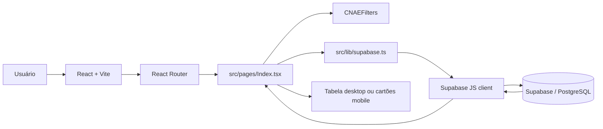

# Consulta CNAE - Risco Sanitário

Aplicação web de consulta pública de atividades econômicas classificadas por nível de risco sanitário para a Superintendência de Vigilância em Saúde de Itajaí/SC. O sistema permite localizar atividades por código CNAE ou descrição, filtrar e ordenar os resultados e visualizar variações cadastradas para o mesmo código.

O projeto resolve a necessidade de disponibilizar uma consulta rápida e responsiva a uma lista de atividades econômicas, sem oferecer operações de cadastro, edição ou exclusão pela interface pública.

## Sobre o projeto

O Consulta CNAE - Risco Sanitário é uma aplicação web pública da Superintendência de Vigilância em Saúde de Itajaí/SC para consultar atividades econômicas e seus respectivos níveis de risco sanitário. A ferramenta permite pesquisar, filtrar, ordenar e visualizar variações de códigos CNAE de forma rápida e responsiva.

## Sumário

- [Funcionalidades](#funcionalidades)
- [Tecnologias](#tecnologias)
- [Arquitetura](#arquitetura)
- [Estrutura do projeto](#estrutura-do-projeto)
- [Pré-requisitos](#pré-requisitos)
- [Configuração](#configuração)
- [Instalação e execução](#instalação-e-execução)
- [Scripts disponíveis](#scripts-disponíveis)
- [Fluxo de consulta](#fluxo-de-consulta)
- [Dados e integração com o Supabase](#dados-e-integração-com-o-supabase)
- [Rotas](#rotas)
- [Build e publicação](#build-e-publicação)
- [Segurança](#segurança)
- [Limitações e pontos de atenção](#limitações-e-pontos-de-atenção)
- [Manutenção e evolução](#manutenção-e-evolução)

## Funcionalidades

- Consulta pública de atividades econômicas classificadas por risco sanitário.
- Busca textual por código CNAE ou descrição da atividade.
- Debounce de 300 ms na busca para evitar consultas a cada tecla digitada.
- Filtro por nível: `I - Baixo`, `II - Médio`, `III - Alto` ou todos os níveis.
- Ordenação crescente por código CNAE ou descrição.
- Paginação de 50 registros por página na consulta padrão.
- Agrupamento das linhas pelo código CNAE.
- Expansão de códigos que possuem mais de uma descrição ou classificação de risco.
- Filtro para exibir somente códigos com variações.
- Destaque visual das linhas conforme o nível de risco.
- Legenda visual dos níveis de risco:
  - `I - Baixo`: verde;
  - `II - Médio`: amarelo;
  - `III - Alto`: vermelho.
- Histórico local das cinco buscas mais recentes, armazenado no `localStorage` do navegador.
- Apresentação responsiva: tabela em telas médias/grandes e cartões em telas menores.
- Estados de carregamento, resultado vazio, erro de conexão e indicador de conexão com o Supabase.
- Rota de fallback para páginas não encontradas.

As ações `Novo`, `Editar` e `Excluir` aparecem desabilitadas na interface e indicam que a operação é somente leitura.

## Tecnologias

| Tecnologia | Uso no projeto |
| --- | --- |
| React 18 | Componentização e gerenciamento da interface |
| TypeScript | Tipagem do código-fonte |
| Vite 5 | Servidor de desenvolvimento e build |
| React Router DOM 6 | Roteamento da aplicação |
| Supabase JS | Consulta ao banco PostgreSQL exposto pelo Supabase |
| TanStack React Query | Provedor disponível na árvore da aplicação; a consulta principal usa estado local e Supabase diretamente |
| Tailwind CSS 3 | Estilização utilitária e tema |
| shadcn/ui e Radix UI | Componentes acessíveis de interface |
| Lucide React | Ícones |
| Sonner | Notificações de erro |
| ESLint | Verificação estática |
| PostCSS e Autoprefixer | Processamento de CSS |

As dependências e versões declaradas estão em `package.json`; o lockfile principal para npm é `package-lock.json`. Também existe `bun.lockb`, mas não há script específico de Bun.

## Arquitetura

A aplicação é um SPA (Single-Page Application) sem backend próprio no repositório. O navegador carrega a aplicação React, executa os filtros e realiza consultas diretamente ao Supabase usando a chave pública configurada no frontend.



### Camadas e responsabilidades

- **Entrada e composição:** `src/main.tsx` monta o React; `src/App.tsx` registra providers, roteamento e estados globais de toast.
- **Página principal:** `src/pages/Index.tsx` mantém filtros, paginação, carregamento, erros, histórico local e agrupamento dos resultados.
- **Acesso a dados:** `src/lib/supabase.ts` monta a consulta à tabela `lista_cnae` e converte os registros para os tipos usados pela interface.
- **Cliente de integração:** `src/integrations/supabase/client.ts` cria o cliente tipado do Supabase.
- **Apresentação:** os componentes `CNAE*`, `Risk*`, `LoadingSkeleton`, `EmptyState` e `ErrorState` exibem os diferentes estados e formatos da consulta.
- **Componentes base:** `src/components/ui/` contém componentes reutilizáveis baseados em Radix UI e estilizados com Tailwind.

## Estrutura do projeto

```text
.
├── public/                         # Arquivos estáticos
├── src/
│   ├── components/                 # Componentes da consulta e componentes UI
│   ├── hooks/                      # Hooks reutilizáveis, incluindo debounce
│   ├── integrations/supabase/      # Cliente e tipos do banco
│   ├── lib/                        # Consulta, agrupamento, tema de risco e utilitários
│   ├── pages/                      # Index e página de rota não encontrada
│   ├── App.tsx                     # Providers e rotas
│   ├── main.tsx                    # Ponto de entrada
│   ├── App.css                     # Estilos da aplicação
│   └── index.css                   # Tokens globais e estilos base
├── supabase/
│   ├── migrations/                 # Migrations SQL versionadas
│   └── config.toml                 # Identificador do projeto Supabase
├── index.html                      # Metadados HTML e elemento root
├── package.json                    # Scripts e dependências
├── vite.config.ts                  # Configuração do Vite e alias `@`
├── tailwind.config.ts              # Tema e tokens do Tailwind
├── tsconfig*.json                  # Configurações TypeScript
└── eslint.config.js                # Configuração ESLint
```

## Pré-requisitos

- Node.js compatível com as versões atuais de Vite 5 e TypeScript declaradas no projeto.
- npm, caso sejam usados os scripts documentados abaixo.
- Acesso a um projeto Supabase com a tabela esperada pelo frontend.

O repositório não fixa uma versão de Node.js em `.nvmrc`, `engines` ou arquivo equivalente. Para ambientes de desenvolvimento e CI, recomenda-se definir e padronizar essa versão antes da automação.

## Configuração

Crie um arquivo `.env` na raiz, sem versionar credenciais, com as variáveis usadas pelo cliente Supabase:

```dotenv
VITE_SUPABASE_URL=https://seu-projeto.supabase.co
VITE_SUPABASE_PUBLISHABLE_KEY=sua-chave-publicavel
```

O Vite só expõe ao código do navegador variáveis com o prefixo `VITE_`. O arquivo `src/integrations/supabase/client.ts` usa essas variáveis e possui valores de fallback no código-fonte caso elas não estejam definidas. Em ambientes controlados, prefira configurar explicitamente as variáveis e evitar depender dos fallbacks.

Não copie valores reais de `.env` para documentação, issues, logs ou commits. A chave publicável não substitui as políticas de segurança do banco: o acesso efetivo deve ser controlado pelo Row Level Security (RLS) do Supabase.

## Instalação e execução

Na raiz do repositório:

```bash
npm install
npm run dev
```

O servidor Vite é configurado em `vite.config.ts` para usar a porta `8080` e aceitar conexões no host `::`. A URL normalmente será:

```text
http://localhost:8080
```

Para interromper o servidor, use `Ctrl+C` no terminal.

## Scripts disponíveis

| Comando | Finalidade |
| --- | --- |
| `npm run dev` | Inicia o servidor Vite de desenvolvimento com recarregamento automático |
| `npm run build` | Gera o build de produção em `dist/` |
| `npm run build:dev` | Gera o build usando o modo de desenvolvimento do Vite |
| `npm run lint` | Executa o ESLint no projeto |
| `npm run preview` | Serve localmente o conteúdo já gerado em `dist/` |

Não há scripts de testes automatizados, migração, seed ou servidor backend definidos em `package.json`.

## Fluxo de consulta

1. `Index.tsx` inicializa a tela com busca vazia, todos os níveis, ordenação por código e página 1.
2. A busca digitada passa por `useDebounce` por 300 ms.
3. A página chama `fetchCNAEActivities` quando os filtros ou a página mudam.
4. O cliente Supabase consulta `lista_cnae`, solicitando contagem exata e os campos da tabela.
5. A busca textual usa `ilike` sobre `codigo` e `descricao`; o filtro de risco usa igualdade sobre `nivel`.
6. A consulta é ordenada por `codigo` ou `descricao` e, no fluxo padrão, recebe um intervalo de 50 registros.
7. Os registros são convertidos para `CNAEActivity` e agrupados por código em `groupCNAEByCode`.
8. Grupos com mais de uma entrada podem ser expandidos para visualizar todas as variações.
9. Quando o filtro de variações está ativo, os dados retornados são agrupados no cliente e paginados após o agrupamento.
10. Uma busca não vazia é registrada no `localStorage` com a chave `cnae-recent-searches`, mantendo no máximo cinco itens.

O carregamento bem-sucedido marca a conexão como ativa. Falhas exibem uma mensagem na tela, uma notificação e uma ação de nova tentativa.

## Dados e integração com o Supabase

### Contrato usado pelo frontend

Os tipos gerados em `src/integrations/supabase/types.ts` descrevem a tabela pública `lista_cnae`:

| Campo | Tipo esperado | Uso |
| --- | --- | --- |
| `id` | `string` | Identificador do registro |
| `codigo` | `string` | Código CNAE usado para busca, ordenação e agrupamento |
| `descricao` | `string` | Descrição da atividade usada na busca e exibição |
| `nivel` | `risk_level` | Classificação `I - Baixo`, `II - Médio` ou `III - Alto` |
| `created_at` | `string` | Data de criação, mapeada mas não exibida |
| `updated_at` | `string` | Presente no tipo do banco, não exibido pela interface |

O acesso utilizado pela aplicação é somente a leitura: não há chamadas de `insert`, `update` ou `delete` no frontend.

### Migrations versionadas

As migrations em `supabase/migrations/` devem ser revisadas antes de serem aplicadas a um novo projeto. A primeira migration cria `csf_cnae`, com colunas `codigo_cnae`, `descricao_atividade` e `nivel_risco`, e define o enum como `Baixo`, `Médio` e `Alto`. Já o código atual consulta `lista_cnae`, com `codigo`, `descricao`, `nivel` e valores prefixados (`I - Baixo`, `II - Médio`, `III - Alto`).

Essa divergência indica que as migrations presentes não representam integralmente o schema consumido pelo estado atual do frontend ou estão desatualizadas. A estrutura real do projeto Supabase precisa ser validada antes de executar as migrations em produção. Não é seguro assumir que executar esses arquivos, isoladamente, deixará a aplicação funcional.

A migration também habilita RLS na tabela criada e permite leitura pública, bloqueando inserção, atualização e exclusão. Essas políticas documentam a intenção de uma consulta pública somente leitura, mas devem ser confirmadas para a tabela efetivamente usada (`lista_cnae`).

## Rotas

O roteamento está em `src/App.tsx`:

| Rota | Componente | Comportamento |
| --- | --- | --- |
| `/` | `src/pages/Index.tsx` | Consulta de atividades CNAE |
| `*` | `src/pages/NotFound.tsx` | Exibe página de rota inexistente e registra o caminho no console |

Não há rotas de login, administração, cadastro ou edição implementadas.

## Build e publicação

Para gerar os arquivos estáticos:

```bash
npm run build
```

O resultado é gravado em `dist/`. Para validar localmente o build produzido:

```bash
npm run preview
```

O repositório não contém configuração de CI/CD, Docker, servidor web ou provedor de hospedagem. A publicação deve usar um serviço capaz de servir uma SPA estática e encaminhar rotas desconhecidas para `index.html`, caso sejam acessadas diretamente. As variáveis `VITE_SUPABASE_URL` e `VITE_SUPABASE_PUBLISHABLE_KEY` precisam estar disponíveis durante o build, conforme o mecanismo de configuração do provedor escolhido.

## Segurança

- Nunca versione senhas, tokens, chaves privadas ou valores reais de arquivos `.env`.
- A configuração atual contém fallback de URL e chave publicável em `src/integrations/supabase/client.ts`. A chave publicável pode ser conhecida pelo navegador, mas deve ter permissões limitadas por RLS; credenciais administrativas nunca devem ser colocadas nesse arquivo.
- Confirme que a tabela usada pelo frontend (`lista_cnae`) está com RLS habilitado e com política de leitura compatível com a consulta pública.
- Mantenha bloqueadas as operações de escrita para o perfil público. A interface já não oferece essas operações, mas a proteção deve existir no banco.
- Valide e restrinja origens, políticas e permissões no projeto Supabase conforme o ambiente de publicação.
- O cliente Supabase persiste sessões em `localStorage` e habilita renovação automática, mas a aplicação não implementa fluxo de autenticação nem verifica sessão para liberar funcionalidades.
- Dados armazenados em `localStorage` neste projeto são apenas termos de busca recentes; não devem ser usados para guardar informações sensíveis.
- Revise o histórico Git e os arquivos de ambiente antes de publicar o repositório. O `.gitignore` atual inclui `*.env`, mas arquivos e credenciais que já tenham sido versionados precisam ser tratados separadamente.

## Limitações e pontos de atenção

- A aplicação depende diretamente da disponibilidade e do schema do Supabase; não há camada intermediária de API ou cache próprio.
- A busca usa `ilike` em código e descrição. A performance e a semântica da busca dependem dos índices e do volume da tabela real.
- Quando `Mostrar apenas códigos com variações` está ativo, a consulta desativa a paginação no banco (`range`) e traz todos os registros filtrados para agrupamento no navegador. Grandes volumes podem aumentar o tempo de resposta e o consumo de memória.
- O total exibido na consulta padrão vem da contagem exata do Supabase; no modo de variações, a contagem é calculada a partir dos grupos carregados no cliente.
- Não há testes automatizados, cobertura, validação de schema em runtime ou pipeline de integração contínua no repositório.
- Não há fluxo de autenticação, perfis, autorização administrativa, manutenção de dados, upload de arquivos, armazenamento de arquivos, geração de documentos ou integração com Firebase.
- O componente `QueryClientProvider` está configurado, mas o fluxo de consulta principal não usa hooks do TanStack Query.
- A divergência entre as migrations e o contrato consumido pelo frontend precisa ser resolvida antes de novos ambientes serem provisionados.
- A aplicação possui fallbacks para configuração do Supabase no código; isso reduz a clareza de configuração por ambiente e deve ser avaliado antes de uma publicação institucional.

## Manutenção e evolução

### Alteração da interface

1. Componentes específicos da consulta ficam em `src/components/`.
2. A composição e as regras de estado da tela ficam em `src/pages/Index.tsx`.
3. Cores e comportamento visual dos níveis de risco ficam em `src/lib/riskTheme.ts` e nos tokens de `src/index.css`.
4. Componentes genéricos devem seguir o padrão existente em `src/components/ui/`.

### Alteração do contrato de dados

1. Confirme o schema no Supabase antes de alterar a consulta.
2. Atualize `src/integrations/supabase/types.ts` de forma consistente com o schema real.
3. Atualize o mapeamento em `src/lib/supabase.ts` e os filtros dependentes dos valores do enum.
4. Registre a mudança em uma migration versionada e valide-a em um ambiente separado.
5. Execute `npm run lint` e `npm run build` antes de abrir uma alteração.

### Checklist de desenvolvimento

```bash
npm install
npm run lint
npm run build
npm run preview
```

Durante a revisão manual, verifique busca por código e descrição, cada nível de risco, paginação, agrupamento de variações, comportamento responsivo, estado sem resultados e falha de conexão com o Supabase.

## Referências principais

- `src/pages/Index.tsx`: fluxo da tela e estado da consulta.
- `src/lib/supabase.ts`: consulta, mapeamento e agrupamento dos dados.
- `src/integrations/supabase/client.ts`: criação do cliente Supabase e configuração de ambiente.
- `src/integrations/supabase/types.ts`: contrato TypeScript do banco usado pelo frontend.
- `src/components/CNAEFilters.tsx`: filtros e ordenação disponíveis.
- `src/components/CNAETableDesktop.tsx` e `src/components/CNAECardsMobile.tsx`: apresentação responsiva e variações.
- `supabase/migrations/`: histórico SQL que requer alinhamento com o schema atualmente consultado.
